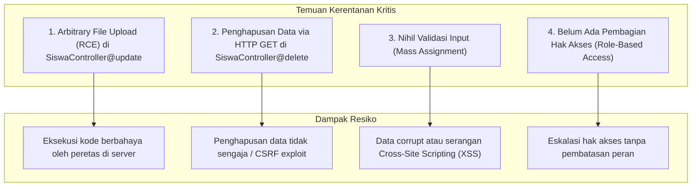
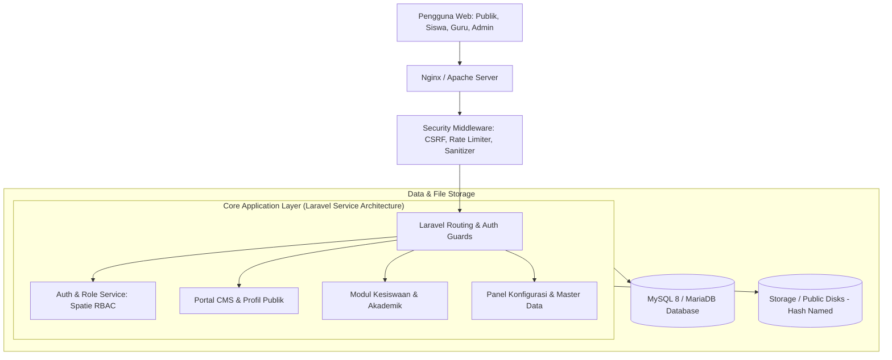
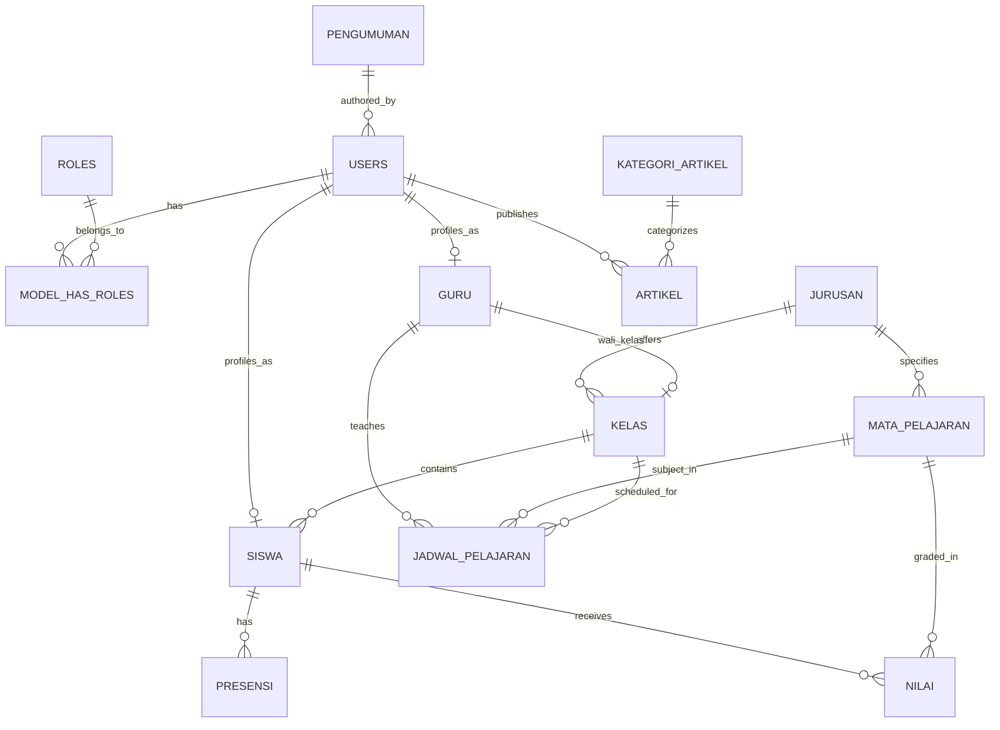

# BLUEPRINT PENGEMBANGAN SISTEM INFORMASI & PORTAL RESMI SMKN 1 PADAHERANG
**Dokumen Arsitektur Sistem, Roadmap Refactoring, dan Cetak Biru Pengembangan Berkelanjutan**

---

## 📑 Daftar Isi
1. [Ringkasan Eksekutif & Visi Proyek](#1-ringkasan-eksekutif--visi-proyek)
2. [Analisis Kondisi Sistem Saat Ini (As-Is Analysis)](#2-analisis-kondisi-sistem-saat-ini-as-is-analysis)
3. [Arsitektur Target Sistem (To-Be Architecture)](#3-arsitektur-target-sistem-to-be-architecture)
4. [Pemodelan Basis Data & Desain ERD Target](#4-pemodelan-basis-data--desain-erd-target)
5. [Protokol Keamanan & Standarisasi Kode (Security Hardening)](#5-protokol-keamanan--standarisasi-kode-security-hardening)
6. [Langkah Refactoring Segera (Immediate Quick-Wins)](#6-langkah-refactoring-segera-immediate-quick-wins)
7. [Roadmap Implementasi Bertahap (Sprint Execution Plan)](#7-roadmap-implementasi-bertahap-sprint-execution-plan)

---

## 1. Ringkasan Eksekutif & Visi Proyek

Aplikasi **WEBSMK_NOVI** awalnya dibangun sebagai purwarupa (prototype) website profil sekolah dan pencatatan siswa SMKN 1 Padaherang berbasis framework Laravel 5.8. 

### Visi Target
Mentransformasi aplikasi ini dari web statis sederhana menjadi **Integrated School Management System (Sistem Informasi Manajemen Sekolah Terintegrasi)** yang melayani 4 pilar pengguna utama:
1. **Masyarakat & Calon Siswa**: Media informasi resmi, profil 8 kompetensi keahlian, prestasi, publikasi agenda/berita, serta portal PPDB Online.
2. **Manajemen Sekolah & Administrator**: Pengelolaan master data akademik, inventaris konten web (CMS), hak akses pengguna, dan audit logging.
3. **Guru & Tenaga Pendidik**: Pengelolaan kelas, jadwal mengajar, pencatatan presensi, dan penilaian siswa.
4. **Siswa & Wali Murid**: Akses portal nilai raport, informasi presensi, pengumuman sekolah, dan data profil pribadi.

---

## 2. Analisis Kondisi Sistem Saat Ini (As-Is Analysis)

### 2.1 Kekuatan yang Ada (Existing Strengths)
- Telah mengintegrasikan template antarmuka berkualitas: **Canvas HTML5 Template** untuk portal publik dan **Klorofil Admin** untuk panel pengelolaan.
- Struktur routing terpisah rapi antara modul profil sekolah, keahlian jurusan, dan backend siswa.
- Konsep dasar Eloquent ORM telah digunakan untuk entitas `Siswa` dan `User`.

### 2.2 Kelemahan & Hutang Teknis (Technical Debts)
- **Framework Usang**: Laravel 5.8 (rilis 2019) telah mencapai End-of-Life (EOL) dan tidak kompatibel secara bawaan dengan PHP 8.1+.
- **Konten Statis (Hardcoded)**: Profil sejarah, visi-misi, kepala sekolah, dan data kejuruan tertulis permanen di berkas Blade (`resources/views/sites/`). Tidak ada panel admin untuk mengubah teks atau gambar tanpa mengedit kode sumber.
- **Inkonsistensi Naming Convention**:
  - File model: `app/siswa.php` (huruf kecil), namun diimport dengan `\App\Siswa` (huruf kapital). Ini menimbulkan kegagalan fatal (*Class not found*) pada sistem berkas peka huruf besar-kecil (Linux/Unix).
  - Penamaan metode controller tidak konsisten mengikuti standar PSR (`Index`, `Create`, `edit`, `Profile`).
- **Diskrepansi Migrasi Database**: Kolom `avatar` digunakan di model dan form, tetapi tidak terdefinisi di migration `database/migrations/2019_07_25_061242_create_siswa_table.php`.
- **Tidak Tersedia Seeder & Factory Lengkap**: DatabaseSeeder dalam keadaan kosong tanpa akun admin awal.

### 2.3 Kerentanan Keamanan Kritis (Security Vulnerabilities)



---

## 3. Arsitektur Target Sistem (To-Be Architecture)



### Rekomendasi Teknologi Modernisasi:
- **Backend**: Upgrade bertahap ke **Laravel 10.x / 11.x** (PHP 8.2+).
- **Database**: MySQL 8.0+ atau MariaDB 10.6+.
- **Manajemen Hak Akses**: Spatie Laravel-Permission.
- **Manajemen Berkas**: Storage Disk terabstraksi dengan Intervention Image v3 untuk pengubahan ukuran otomatis dan sanitasi metadata gambar.
- **Panel Admin Alternatif Masa Depan**: Filament v3 (TALL Stack) untuk admin panel modern dan otomatis CRUD.

---

## 4. Pemodelan Basis Data & Desain ERD Target

Berikut rancangan skema basis data menyeluruh untuk mendukung evolusi sistem menjadi sistem informasi sekolah terpadu:



### Rincian Tabel Utama:

#### 1. Tabel Master Akademik & Kesiswaan
- **`jurusan`**: `id`, `kode_jurusan`, `nama_jurusan`, `deskripsi`, `visi_misi`, `prospek_kerja`, `icon`, `gambar`, `is_active`, `timestamps`.
- **`kelas`**: `id`, `jurusan_id` (FK), `guru_id` (FK: Wali Kelas), `tingkat` (10/11/12), `nama_kelas`, `tahun_ajaran`, `timestamps`.
- **`siswa`**: `id`, `user_id` (FK, nullable), `kelas_id` (FK), `nis`, `nisn`, `nama_lengkap`, `jenis_kelamin` (enum: L, P), `tempat_lahir`, `tanggal_lahir`, `alamat`, `nomor_telepon`, `nama_ayah`, `nama_ibu`, `nomor_wali`, `avatar`, `status` (aktif, lulus, pindah), `timestamps`.
- **`guru`**: `id`, `user_id` (FK), `nip`, `nama_guru`, `gelar`, `jenis_kelamin`, `bidang_studi`, `telepon`, `foto`, `status_kepegawaian`, `timestamps`.

#### 2. Tabel Akademik & Absensi
- **`mata_pelajaran`**: `id`, `kode_mapel`, `nama_mapel`, `jurusan_id` (nullable), `kelompok` (Normatif, Adaptif, Produktif), `kkm`.
- **`jadwal_pelajaran`**: `id`, `kelas_id` (FK), `mapel_id` (FK), `guru_id` (FK), `hari`, `jam_mulai`, `jam_selesai`.
- **`presensi_siswa`**: `id`, `siswa_id` (FK), `tanggal`, `status` (Hadir, Sakit, Izin, Alpa), `keterangan`.
- **`nilai_siswa`**: `id`, `siswa_id` (FK), `mapel_id` (FK), `semester` (Ganjil/Genap), `tahun_ajaran`, `nilai_tugas`, `nilai_uts`, `nilai_uas`, `nilai_akhir`.

#### 3. Tabel CMS Profil & Publikasi
- **`kategori_artikel`**: `id`, `nama_kategori`, `slug`.
- **`artikel`**: `id`, `user_id` (author), `kategori_id` (FK), `judul`, `slug`, `konten`, `thumbnail`, `status` (draft/published), `views_count`, `published_at`, `timestamps`.
- **`pengumuman`**: `id`, `judul`, `slug`, `isi_pengumuman`, `berkas_lampiran`, `target_audiens` (semua/siswa/guru), `is_urgent`, `tanggal_berakhir`, `timestamps`.
- **`galeri_kegiatan`**: `id`, `judul_kegiatan`, `kategori`, `gambar`, `deskripsi`, `tanggal_kegiatan`.

---

## 5. Protokol Keamanan & Standarisasi Kode (Security Hardening)

### 5.1 Perbaikan Penanganan Unggah Berkas (Upload Sanitization)
```php
// CONTOH KODE AMAN PADA SISWA REQUEST / CONTROLLER:
public function update(SiswaUpdateRequest $request, $id)
{
    $siswa = Siswa::findOrFail($id);
    $validated = $request->validated();

    if ($request->hasFile('avatar')) {
        // Hapus avatar lama bila bukan default
        if ($siswa->avatar && Storage::disk('public')->exists('avatars/' . $siswa->avatar)) {
            Storage::disk('public')->delete('avatars/' . $siswa->avatar);
        }

        // Simpan dengan hash unik, ekstensi terverifikasi
        $file = $request->file('avatar');
        $fileName = 'avatar_' . uniqid() . '.' . $file->getClientOriginalExtension();
        $file->storeAs('avatars', $fileName, 'public');
        $validated['avatar'] = $fileName;
    }

    $siswa->update($validated);
    return redirect()->route('siswa.index')->with('sukses', 'Data siswa berhasil diperbarui');
}
```

### 5.2 Standarisasi Validasi Formulir (FormRequest)
Buat FormRequest terpisah untuk create dan update:
```bash
php artisan make:request SiswaRequest
```
Dengan rules ketat:
- `nis`: `required|numeric|unique:siswa,nis`
- `nama_siswa`: `required|string|max:100`
- `jenis_kelamin`: `required|in:L,P`
- `kelas`: `required|string|max:20`
- `komp_keahlian`: `required|string|max:50`
- `avatar`: `nullable|image|mimes:jpeg,png,jpg|max:2048`

### 5.3 Perbaikan Metode Hapus (RESTful & Proteksi CSRF)
Ganti rute GET dengan rute DELETE:
```php
// routes/web.php
Route::delete('/siswa/{id}', 'SiswaController@destroy')->name('siswa.destroy');
```
Dan pada view gunakan form submit dengan method spoofing:
```html
<form action="{{ route('siswa.destroy', $siswa->id) }}" method="POST" style="display:inline;">
    @csrf
    @method('DELETE')
    <button type="submit" class="btn btn-danger btn-sm" onclick="return confirm('Apakah Anda yakin ingin menghapus data ini?')">Hapus</button>
</form>
```

---

## 6. Langkah Refactoring Segera (Immediate Quick-Wins)

| No | Tugas Refactoring | Tingkat Prioritas | Berkas Terdampak |
| :--- | :--- | :--- | :--- |
| **1** | Normalisasi nama Model ke PSR-4 PascalCase | **Kritis** | `app/siswa.php` diubah menjadi `app/Siswa.php` |
| **2** | Perbaiki skema migrasi tabel siswa (tambahkan kolom avatar) | **Kritis** | `database/migrations/2019_07_25_061242_create_siswa_table.php` |
| **3** | Pasang validasi form request pada Create & Update siswa | **Kritis** | `app/Http/Controllers/SiswaController.php` |
| **4** | Amankan unggah file avatar (validasi mimes, sanitasi nama berkas) | **Kritis** | `app/Http/Controllers/SiswaController.php` |
| **5** | Ubah rute delete siswa dari GET menjadi DELETE ber-CSRF | **Tinggi** | `routes/web.php`, `resources/views/siswa/index.blade.php` |
| **6** | Buat `DatabaseSeeder` dengan default administrator | **Tinggi** | `database/seeds/DatabaseSeeder.php` |
| **7** | Tambahkan file `.env.example` dan `.gitignore` di root repositori | **Tinggi** | Root directory |

---

## 7. Roadmap Implementasi Bertahap (Sprint Execution Plan)

### Fase 1: Stabilisasi, Keamanan & Refactoring Awal (Minggu 1 - 2)
- [x] Audit komprehensif basis kode dan penyusunan blueprint sistem.
- [x] Pembuatan berkas standar repositori (`.gitignore`, `.env.example`, `README.md`).
- [x] Refactoring penamaan Model (`Siswa.php`) dan perbaikan migrasi database (kolom `avatar`).
- [x] Penutupan celah keamanan file upload dan pengubahan rute penghapusan ke DELETE method.
- [x] Implementasi Form Request validation dan flash message feedback yang aman.
- [x] Penyusunan Data Seeder (Dummy Siswa & Akun Superadmin default).
- [x] Pembuatan automated feature & security test suite (8 tests, 20 assertions lulus 100%).

### Fase 2: Transformasi CMS Konten Sekolah Dinamis (Minggu 3 - 4)
- [x] Pembuatan skema database & model CMS (`kategori_artikel`, `artikel`, `pengumuman`, `jurusan`).
- [x] Pembuatan panel admin CRUD Berita, Artikel, dan Pengumuman Sekolah.
- [x] Modul Manajemen Data Jurusan dinamis di admin panel.
- [x] Portal publik warta sekolah (`/berita`, `/berita/{slug}`) dan pengumuman (`/pengumuman`, `/pengumuman/{slug}`).
- [x] Integrasi konten dinamis ke homepage (`home.blade.php`) dan navbar utama.
- [x] Data Seeder CMS (kategori, warta awal, pengumuman, 8 kompetensi keahlian).
- [x] Automated test suite CMS (`CmsModuleTest.php` - total 16 tests lulus 100%).

### Fase 3: Pengembangan Modul Kesiswaan & Akademik (Minggu 5 - 8)
- [x] Pembuatan entitas & skema Guru, Kelas, dan Mata Pelajaran.
- [x] Sistem peran pengguna (Role-Based Access: column `role` di `users` & helper checks).
- [x] Modul Presensi Siswa harian dengan kalkulasi metrik ringkasan (Hadir, Sakit, Izin, Alpa).
- [x] Modul input nilai & kalkulasi nilai akhir otomatis (Tugas 30%, UTS 30%, UAS 40%) beserta predikat (A/B/C/D).
- [x] Cetak Transkrip Nilai / Raport Belajar Siswa (`/admin/nilais/transkrip/{id}`).
- [x] Halaman profil detail siswa dinamis dengan tab nilai & presensi terintegrasi.
- [x] Direktori guru publik (`/dataGuru`).
- [x] Automated test suite akademik (`AcademicModuleTest.php` - total 23 tests lulus 100%).

### Fase 4: Modernisasi Platform & Fitur Interaktif Lanjutan (Minggu 9 - 12)
- [x] Modul PPDB (Penerimaan Peserta Didik Baru) Online:
  - [x] Skema basis data & model `ppdb_pendaftaran` terintegrasi 8 jurusan.
  - [x] Portal informasi & alur pendaftaran daring (`/ppdb`).
  - [x] Form registrasi calon peserta didik (`/ppdb/daftar`) dengan validasi NISN & unggah berkas (Ijazah, KK, Akta).
  - [x] Cek status pendaftaran mandiri calon siswa (`/ppdb/cek-status`).
  - [x] Lembar bukti pendaftaran resmi siap cetak (`/ppdb/bukti/{nomor}`).
  - [x] Panel admin verifikasi berkas, keputusan panitia, & filter jurusan (`/admin/ppdb`).
  - [x] Data Seeder calon pendaftar PPDB (`PpdbTableSeeder.php`).
  - [x] Automated test suite PPDB (`PpdbModuleTest.php` - total 29 tests lulus 100%).
- [ ] Panduan Migrasi Framework Modern ke Laravel 10/11 (PHP 8.2+):
  - [ ] Pembaruan struktur directory Laravel 11 (bootstrap/app.php unified configuration).
  - [ ] Implementasi Filament v3 Admin Panel untuk modernisasi UI Klorofil.
  - [ ] Konfigurasi caching Redis & antrian worker (queues) untuk notifikasi WhatsApp gateway.

---

*Cetak biru ini dirancang sebagai panduan standar pengembangan perangkat lunak bagi tim teknis SMKN 1 Padaherang.*
